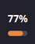
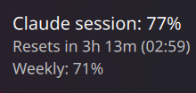
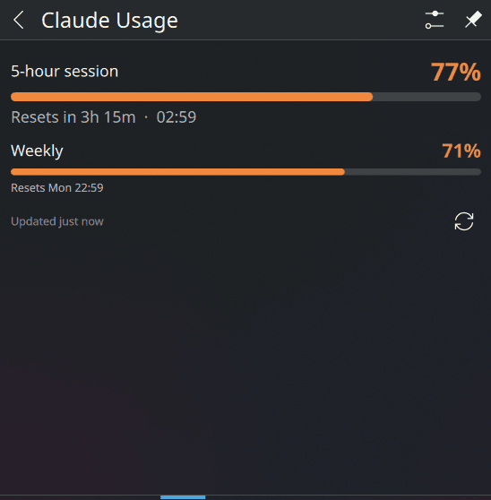

# Claude Usage – KDE Plasma widget

A small KDE Plasma 6 widget that shows your Claude **5-hour session usage** in the system tray or on a panel, so you don't have to keep checking the usage page in your browser.

- **Tray/panel:** the session percentage with a fill bar underneath. The colour changes with usage:
  - green below 50%
  - orange from 50–80%
  - red above 80%
- **Hover:** a tooltip with the percentage, a countdown to the reset ("Resets in 2h 14m") and the reset time, plus your weekly usage.
- **Click:** a popup with the same details and a refresh button. Middle-click refreshes without opening it.

| Tray | Tooltip | Popup |
|:---:|:---:|:---:|
|  |  |  |

## How it works

The widget reads the login token that [Claude Code](https://claude.com/claude-code) stores in `~/.claude/.credentials.json`. It uses that token to ask Anthropic's usage API for the same figures shown on the Claude usage page. You don't need to log in separately or keep a browser open.

The usage API is strictly rate-limited, so the widget:

- calls the API **at most once every 5 minutes**. Results are cached in `~/.cache/claude-usage/` and shared by every copy of the widget, so clicking refresh repeatedly won't add requests.
- waits as long as the server asks if it gets a `429 Too Many Requests` response
- keeps showing the last good numbers when something goes wrong. If the data is more than 15 minutes old, the icon is dimmed, and the popup shows when it last updated.

> **Note:** the usage API is not officially documented and could change without notice. If the widget stops working after an Anthropic update, the helper script may need adjusting.

## Requirements

- KDE Plasma 6
- Python 3.11 or newer (standard library only, nothing to `pip install`)
- Claude Code installed and logged in with your Claude account (Pro/Max)

## Install

```sh
git clone https://github.com/Hodglim/claude-usage.git
cd claude-usage
./install.sh
```

Then add the widget in one of these ways:

- **System tray:** right-click the tray's arrow (^) → *Configure System Tray…* → *Entries* → find **Claude Usage** and set it to **Always shown**.
- **Panel:** right-click the panel → *Add Widgets…* → search for **Claude Usage** and drag it onto the panel.

## Updating

After changing any files, re-run the installer and restart Plasma:

```sh
./install.sh
systemctl --user restart plasma-plasmashell
```

Updates are copied over the existing install, so the widget stays where you put it in the tray or panel.

## Uninstall

```sh
kpackagetool6 -t Plasma/Applet -r org.hodglim.claudeusage
rm -rf ~/.cache/claude-usage
```

## Troubleshooting

| What you see | What to do |
|---|---|
| Popup says "Login token expired" or "rejected" (icon dimmed, or a grey **?** if no data yet) | Run Claude Code once. It renews the token automatically, and the widget picks it up at its next update. |
| "No Claude Code login found" | Install Claude Code and log in (`claude`, then `/login`). |
| "Rate limited by usage API" | Nothing. The widget waits as the server asks and recovers by itself, and the last known numbers stay on screen. |
| Want to test the data source directly | Run `python3 package/contents/code/fetch_usage.py`. It prints the JSON the widget reads. |

## Project layout

```
install.sh                         install/upgrade helper
package/metadata.json              Plasma widget metadata
package/contents/ui/main.qml       the widget (tray icon, tooltip, popup)
package/contents/code/fetch_usage.py   fetches usage, handles caching and rate limits
```

## License

[MIT](LICENSE)
